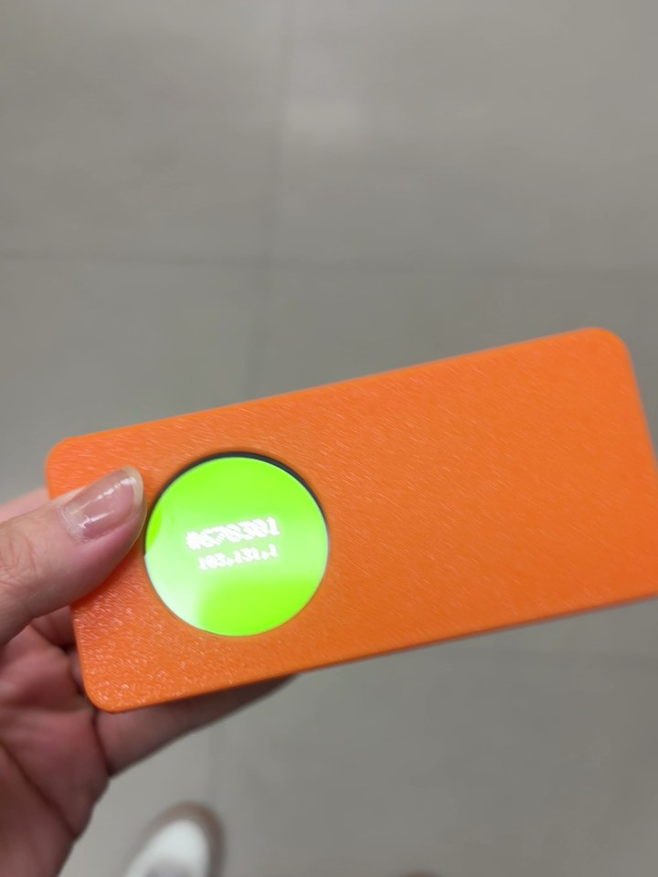

# NU40 DK 실물 컬러 피커

카메라로 **겨눈 곳의 색**을 읽어서, 원형 화면을 그 색으로 가득 채우고 `#RRGGBB` 를 띄웁니다.
길에서 본 간판·나뭇잎·벽 색을 그대로 색코드로 가져오는 손바닥만 한 스포이드예요.



```
OV5647 카메라 ─▶ Grove Vision AI V2 ──I2C──▶ NU40 DK ──SPI──▶ GC9A01 원형 LCD
               (240×240 JPEG 한 장)        base64 풀기 → JPEG 디코드
                                           → 가운데 평균색 → 색보정 → #RRGGBB
```

색센서 대신 **카메라**를 씁니다. 그래서 갖다 댈 필요 없이 **30cm 이상 떨어져서 겨누면** 됩니다
(렌즈가 고정초점 30cm~∞). 화면 가운데 영역의 평균을 내니 30cm 앞에서 약 6cm 크기 색면을 읽는 셈이에요.

## 들어간 것

| 부품 | 역할 |
|---|---|
| NUCODE **NU40 DK** (nRF52840) | 이미지 받기 · JPEG 디코드 · 색 계산 · 화면 그리기 |
| **Grove Vision AI V2** + OV5647 카메라 | 사진 한 장을 찍어 I2C 로 넘김 (주소 `0x62`) |
| **GC9A01** 1.28" 원형 LCD 240×240 | 색 + 헥스 표시 |
| LiPo 3.7V 1500mAh | 보드 배터리 커넥터에 직결 → 무선 |
| 3D 프린트 케이스 | [`case/`](case/) |

## 배선

카메라와 화면 모두 NU40 DK 3V3 하나로 돌아갑니다.

| 카메라 (Grove 4선) | NU40 DK |
|---|---|
| 🟡 노랑 SCL | **P0.27** |
| ⚪️ 흰색 SDA | **P0.26** |
| 🔴 빨강 VCC | **3V3** |
| ⚫️ 검정 GND | **GND** |

| LCD | NU40 DK (Arduino 핀) |
|---|---|
| VCC / GND | 3V3 / GND |
| SCL (SCK) | P1.15 (47) |
| SDA (MOSI) | P1.13 (45) |
| CS | P1.12 (44) |
| DC | P1.11 (43) |
| RES | P1.10 (42) |
| BLK | P1.09 (41) — 3V3 직결 말고 핀에 (밝기·소등 제어) |

- Grove 케이블은 양끝이 Grove 하우징이라 한쪽을 잘라 보드에 납땜했습니다.
- 빨강을 3V3 에 꽂았으면 **센서 자체 USB-C 는 꽂지 마세요** (전원 두 개 충돌).
- 3V3·GND 선이 바로 옆 P0.26·P0.27 과 닿으면 카메라가 안 읽힙니다(화면에 `...` 만 뜸). 납땜 후 합선부터 보세요.

## 펌웨어

| 폴더 | 하는 일 |
|---|---|
| [`firmware/display_test`](firmware/display_test) | 화면만 켜 보기 — LCD 배선 확인 |
| [`firmware/cam_probe`](firmware/cam_probe) | 카메라가 이미지를 주는지 raw 로 확인 (진단용) |
| [`firmware/color_pick`](firmware/color_pick) | **본 펌웨어** |

라이브러리 매니저에서 **JPEGDEC** (Larry Bank), **GFX Library for Arduino** (moononournation) 설치 후:

```sh
arduino-cli compile --fqbn nucode:nrf52:nu40dk firmware/color_pick
arduino-cli upload  --fqbn nucode:nrf52:nu40dk -p /dev/cu.usbmodemXXXX firmware/color_pick
```

보드 매니저에 NUCODE nRF52 코어(`nucode:nrf52`)가 있어야 합니다.

### 어떻게 읽나

1. Grove Vision AI V2 에 `AT+INVOKE` 로 카메라를 먼저 깨우고, 이어서 `AT+SAMPLE=1` 을 보내면 **240×240 JPEG** 한 장이 base64 로 옵니다(약 2.5KB).
   깨우지 않고 SAMPLE 만 보내면 카메라가 식어 있어 타임아웃이 자주 납니다.
2. I2C 는 코어 `Wire` 대신 타임아웃이 있는 직접 제어(`i2c_safe.h`)로 받습니다. 코어 Wire 는 응답이 없으면 그대로 멈춥니다.
3. JPEGDEC 로 블록 단위로 풀면서 **가운데 네모 영역만** 평균을 냅니다 — 전체 프레임을 RAM 에 안 들고도 됩니다.
4. 카메라 원색은 탁하고 빨강에 초록이 섞여서, 기준색 5개를 재서 맞춘 **3×3 색보정 행렬(CCM)** 을 곱하고 채도를 올립니다.
5. 프레임끼리 부드럽게 이어지도록 스무딩하고, **색이 바뀔 때만** 화면을 다시 그립니다.

### 시리얼 명령 (115200)

| 보내기 | 효과 |
|---|---|
| `s2.0` | 채도 바꾸기 (즉시 반영, 리셋하면 기본값) |
| `u` | UF2 부트로더로 들어감 → 리셋 버튼 더블탭 없이 다시 굽기 |

### 안 될 때

- 화면에 `...` 만 계속 → 카메라 캡처 실패. SDA/SCL 선(합선·접촉) 확인 후 **전원을 껐다 켜기**.
- 센서가 응답 안 함 → 브라우저에 SenseCraft 탭이 열려 있으면 센서가 I2C 를 안 봅니다. 닫으세요.
- 빨강이 파랗게 나옴 → 패널 색순서 차이. `color_pick.ino` 의 MADCTL `0x08` ↔ `0x00` 바꾸기.
